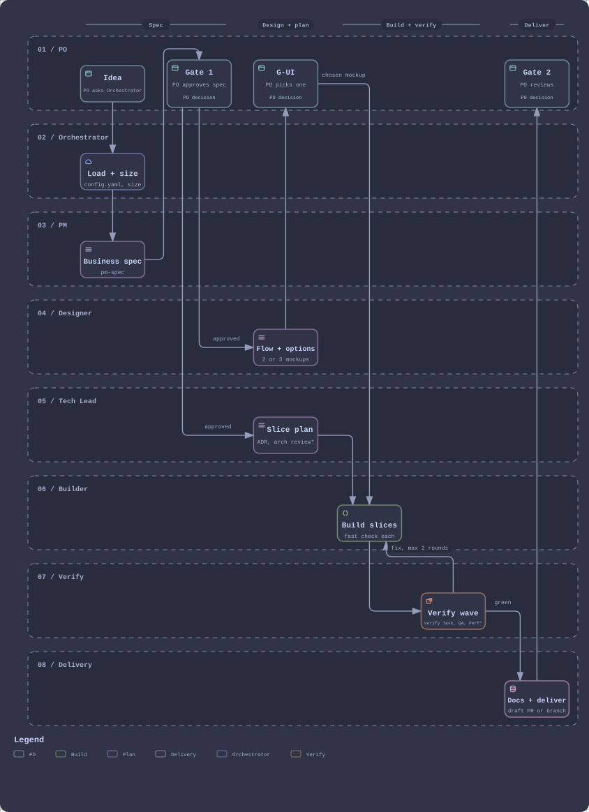
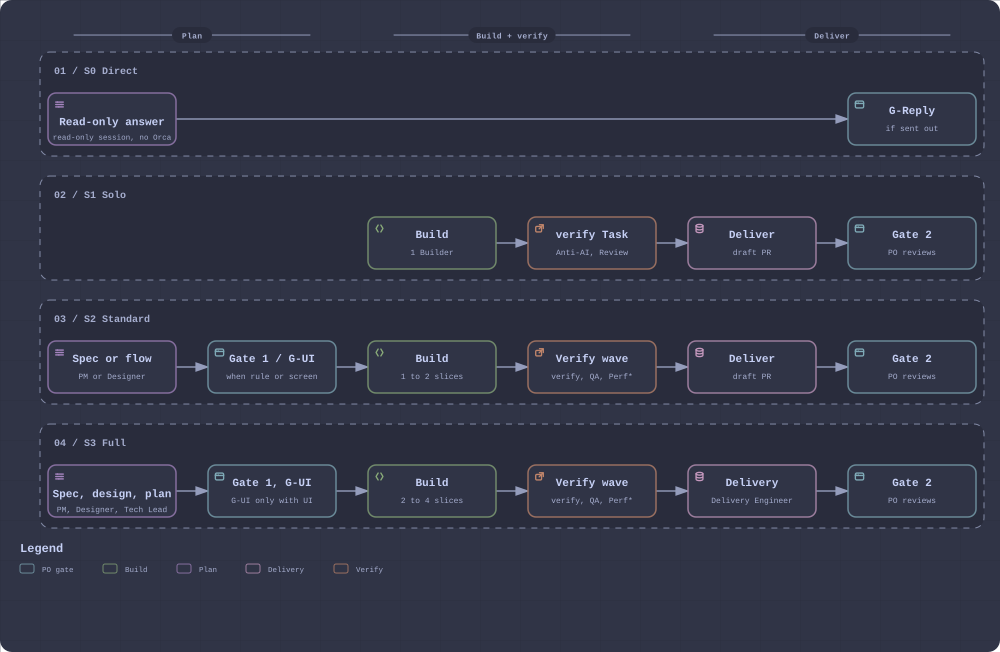

# Software Dev Agent Team

A process for a team of coding agents working a software project inside the Orca app. A human Product Owner approves at fixed gates (business spec, new screens, delivery); an Orchestrator, which can be any coding agent, sizes the work, dispatches role workers (Designer, Tech Lead, Builder, QA, reviewers, Delivery) and ends at a draft PR or a committed branch. Per-project specifics live in a project config, `.team/config.yaml`.

Vietnamese docs for the Product Owner: https://yushaku.github.io/agent-dev-team/

## How it works

Who hands work to whom: the PO talks to the Orchestrator and to discussion sessions; the Orchestrator dispatches every worker.



The main flow for a new capability (S3), with the PO's gates:



What each request size runs:



## Requirements

- macOS with Homebrew
- Claude Code or Codex, installed and signed in
- Everything else is installed below

## Install

Copy each block into a terminal.

1. Tools: Orca, GitHub CLI, jq, Node.

```sh
brew install --cask orca
brew install gh jq node
gh auth login
```

Open Orca once and turn on its CLI, then check: `orca --version`.

2. Clone this repo to `~/.agents/teams` (the default team root).

```sh
git clone https://github.com/yushaku/agent-dev-team.git ~/.agents/teams
```

Cloned elsewhere: `export AGENT_TEAM_HOME=/path/to/clone` in your shell profile.

3. Install the pinned skills globally for Claude Code and Codex.

```sh
cd ~/.agents/teams
jq -r '.skills | to_entries | group_by(.value.source)[]
  | "npx -y skills add \(.[0].value.source) -g -y -a claude-code codex " + (map("-s " + .key) | join(" ")) + " </dev/null"' \
  skills-lock.json | sh
```

Every downloaded skill a role card or `config.md` names is pinned in `skills-lock.json` and never edited in place. Add one by running `npx skills add <repo> -s <name> -a claude-code -y` in a scratch git dir and copying its `skills-lock.json` entry here.

4. Link the team's own skills (`init-team`, `orchestrator`, `anti-ai`, `frappe-docs`).

```sh
cd ~/.agents/teams
mkdir -p ~/.agents/skills ~/.claude/skills
for d in skills/*/; do
  n=$(basename "$d")
  ln -sfn "$PWD/skills/$n" ~/.agents/skills/"$n"
  ln -sfn "$PWD/skills/$n" ~/.claude/skills/"$n"
done
```

Codex reads `~/.agents/skills` directly; Claude Code reads `~/.claude/skills`.

5. Check.

```sh
cd ~/.agents/teams
for n in $(jq -r '.skills | keys[]' skills-lock.json) $(ls skills); do
  test -e ~/.agents/skills/"$n"/SKILL.md || echo "missing: $n"
done; echo "check done"
```

No `missing:` lines means every skill is in place.

## Quickstart

1. Open the project repo in Orca and start Claude Code or Codex in a terminal there.
2. Run `/init-team`: it reads the repo, asks a few questions one at a time and writes `.team/config.yaml` (local, never committed).
3. Run `/orchestrator <job>`, for example `/orchestrator add CSV export to the reports page`.

## Layout

- `workflow.md`: locations, goals, principles, flow, DAG shapes
- `roles/`: one card per worker role
- `skills/orchestrator/`: the Orchestrator skill; `references/` holds its step files, sizing, coding agents, ticket mode and Orca quirks
- `config.md`: project config schema and model settings
- `docs-policy.md`: which documents exist and who owns them
- `skills/`: skills the team wrote
- `skills-lock.json`: pinned downloaded skills
- `scripts/`: helpers such as the quota probe
- `templates/`: file templates for projects
- `diagrams/`: architecture diagrams
- `docs/`: Vietnamese docs site (GitHub Pages)
- `dashboard/`: local dashboard

## Metrics (from Orca history, monthly)

- Lead time: idea to delivery.
- Fix rounds per task (target: 1 or fewer).
- Escaped defects found after merge.
- PO touch time outside the gates.
- Doc weight: committed docs and lines in `docs/` grow with capabilities, not features.
- Tokens per delivered Task, and the Orchestrator's share versus workers (team dashboard, 127.0.0.1:4747).

## Dashboard

The local dashboard shows token metrics only. For the process itself, see the [Vietnamese docs site](https://yushaku.github.io/agent-dev-team/).

`python3 dashboard/server.py`, then open http://127.0.0.1:4747. See `dashboard/README.md`.
